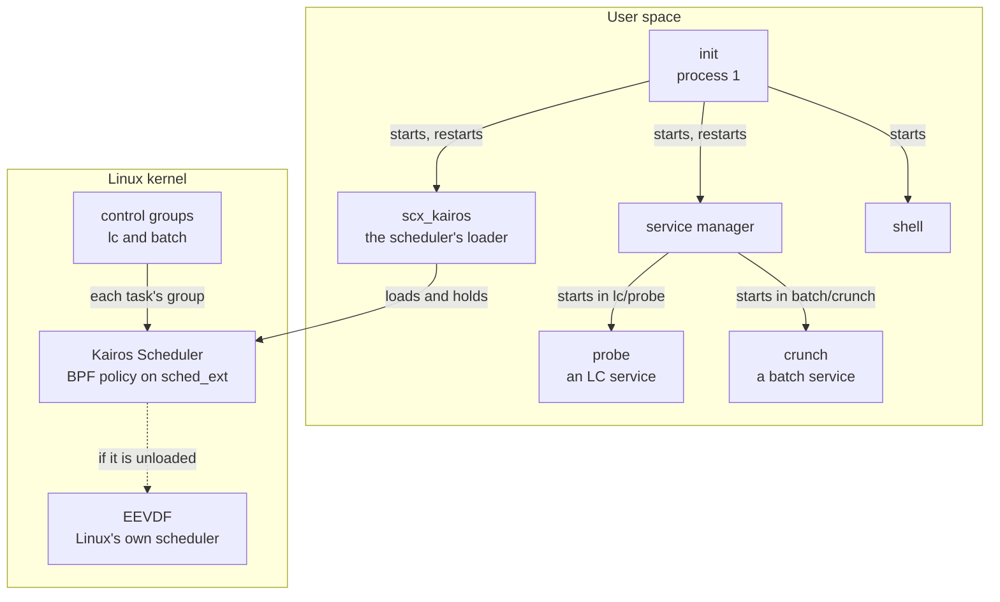
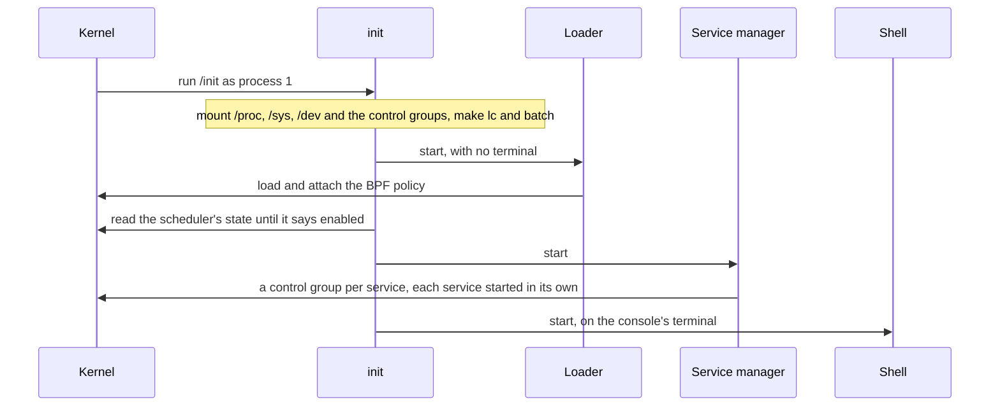

# Kairos

Kairos is an operating system built on the Linux kernel, around
[Kairos Scheduler](https://github.com/AayushNair10/KairOS-Scheduler): a CPU
scheduler for a latency-critical service that shares its CPUs with batch
work.

It has three parts:

- **The kernel:** upstream Linux at a pinned version, plus a short series of
  our own patches (`kernel/`).
- **User space:** our own init and service manager (`userspace/`). The
  shell and tools are busybox's for now.
- **The scheduler:** a BPF program on Linux's sched_ext, kept in its own
  repository and pinned here (`scheduler/`).

## Status

Early. A minimal Kairos kernel builds and boots in QEMU. Kairos's own init
runs as its first process and starts Kairos Scheduler before anything else.
A service manager runs each service in a control group for its class,
latency-critical (LC) or batch, and the scheduler takes every task's class
from its group. There are no kernel patches yet, and the shell and tools
are busybox's. The roadmap, and the reasoning behind each decision, are in
[`docs/DESIGN_LOG.md`](docs/DESIGN_LOG.md).

## Design

### The parts



- **The kernel** decides which task runs where. For ordinary tasks, sched_ext
  lets a BPF program make that decision instead of Linux's own scheduler,
  EEVDF. Kairos Scheduler is such a program. It keeps a pool of CPUs for LC
  work, sized to LC demand; batch work borrows idle LC CPUs, and an LC task
  that wakes up takes its CPU back.
- **The loader** hands the policy to the kernel and holds it there. When the
  loader ends, for any reason, the kernel unloads the policy and gives every
  task back to EEVDF. The kernel also unloads it by itself if the policy
  breaks one of its rules or leaves a task waiting too long.
- **init** is the first program, process 1. It starts the loader before
  anything else, and starts it again when it ends.
- **The service manager** runs the services. Each runs in a control group of
  its own, below the group for its class, and the scheduler reads each
  task's class from its group.

### What happens at boot



Until the policy is attached, only init and the loader run, on EEVDF.
Everything after that runs under Kairos Scheduler.

### How a task gets its class

Control groups are folders in a file system of their own. Every process is
in exactly one, and a new process starts in its parent's group, so a
service and everything it ever starts stay together:

```
/sys/fs/cgroup              init, the shell, the loader, kernel threads  -> LC
├── lc
│   └── probe               the service probe                            -> LC
└── batch
    ├── crunch              the service crunch, and all its processes    -> batch
    └── cmd-123             a command run with "batch"                    -> batch
```

A task is batch if it is anywhere below `batch`, or if it has lowered its
own scheduling policy to batch or idle. Everything else is LC. The kernel
tells the policy a task's group when the task is created and whenever it
moves to another group, so the class costs nothing at each wakeup.

### When something fails

| What happens | Who notices | What follows |
|---|---|---|
| The loader ends: a crash, a kill, an error | the kernel, then init | The kernel gives every task back to EEVDF at once. init starts the loader again: at once after a run of a minute or more, otherwise after 1, 2, 4 and 8 s, and it gives up after five short runs in a row. |
| The policy breaks a kernel rule, or a task waits 30 s | the kernel | It unloads the policy, and the loader ends with a status that says why; then as above. |
| A service ends | the service manager: the service's group is empty | It starts the service again, by the same rule. |
| The service manager ends | init | It starts a new one, which finds the running services by their groups and looks after them. |
| The scheduler itself is the problem | you | Boot with `kairos.noscheduler`: init leaves it off, and EEVDF runs everything. |

## Layout

```
kernel/upstream    the pinned Linux version: its tag and commit id
kernel/patches/    our kernel changes, one numbered patch file each
kernel/config/     the kernel's config: a starting point and our switches
userspace/init/    Kairos's init: the first program the kernel starts
userspace/service/ the service manager, and the service and batch commands
userspace/probe/   a small LC program, run by the demo service probe
image/             the first file system: its list of files, the services'
                   descriptions, the boot test's self-test, and a fallback
                   first program
scheduler/         Kairos Scheduler, a git submodule at a pinned commit
scripts/           the scripts below
docs/              DESIGN_LOG.md: the roadmap and one entry per component
```

## Build and boot

This needs an arm64 Linux machine. On Ubuntu 26.04 these packages were
enough: `git gcc make flex bison bc perl pahole libelf-dev zlib1g-dev
libzstd-dev clang llvm qemu-system-arm busybox-static`.

```sh
git submodule update --init  # once: Kairos Scheduler at the pinned commit
./scripts/kernel-fetch.sh    # once: Linux at the pinned version + our patches
./scripts/kernel-build.sh    # put the config together and build the kernel
./scripts/image-build.sh     # build init, the services and the scheduler; pack the first file system
./scripts/boot-test.sh       # boot unattended and check what the console says
./scripts/run-qemu.sh        # boot to a shell; "poweroff" leaves
```

Everything built goes to `~/kairos-build` (set `KAIROS_BUILD` for another
place). The first build takes a few minutes on 4 CPUs. A boot to the shell
takes a few seconds, even with QEMU emulating every instruction.

## Services

A service is described by a file in `/etc/kairos/services` (from
`image/services/`), named after it:

```
class batch                  lc or batch
start manual                 boot (the default) or manual: only on request
run for i in $(seq $(nproc)); do while :; do :; done & done; wait
```

In the shell:

```sh
service status               # every service: class, state, CPU time used
service start crunch         # start it, reading its description again
service stop crunch          # ask it to finish; whatever is left after 5 s is killed
batch COMMAND                # run one command as batch work
```

The two demo services are `probe`, which wakes every 10 ms and logs how late
its wakeups were (`/run/service/probe/log`), and `crunch`, one busy loop per
CPU, started only on request.

## Init

`userspace/init/init.c` is the first program the kernel starts, and the
parent of everything else. It:

- mounts the file systems through which the kernel shows its own
  information, and the control groups, with the groups `lc` and `batch`;
- starts Kairos Scheduler's loader, and waits until the kernel runs the
  scheduler before it starts anything else;
- when the loader ends, reads its exit status and starts it again, unless
  it was stopped on purpose; after a short run it waits 1, 2, 4 and 8 s
  first, and after five short runs in a row it gives up. Meanwhile the
  kernel's own scheduler runs everything;
- starts the service manager, and starts it again when it ends;
- starts a shell, on the terminal behind the console, and starts a new one
  when that shell ends;
- collects every process that finishes, including the ones it adopted
  because their parent finished first;
- on `poweroff`, `reboot` or `halt`, asks every process to finish, waits,
  stops by force what is left, and only then tells the kernel.

`boot-test.sh` checks each of these on a running system. If the scheduler
is ever what's broken, `./scripts/run-qemu.sh kairos.noscheduler` boots
without it. If init is, `./scripts/run-qemu.sh rdinit=/init.fallback`
boots with a shell script in its place.

## The scheduler

`scheduler/` is the Kairos Scheduler repository, pinned to a commit on its
branch `kairos-os`. That branch holds the changes made for this OS, so the
repository's `main` stays as it was evaluated:

- the loader's `--quiet` option, and an exit status that says why it ended;
- `--class=cgroup` and `--batch-cgroup`: a task's class from its control
  group.

`scripts/scheduler-build.sh`, which `image-build.sh` runs, builds the BPF
library, bpftool and a header of the kernel's types from the pinned kernel
source, then the loader as one statically linked program. It goes into the
image as `/bin/scx_kairos`. The kernel switches it needs are in
`kernel/config/kairos.config`, each with the failure that showed it was
missing.

## The kernel tree

The Linux source isn't stored in this repository. `kernel/upstream` names
the version, `kernel/patches/` holds our changes to it, and
`kernel-fetch.sh` puts the two together into a working tree outside the
repository (`~/kairos-linux`; set `KAIROS_LINUX` for another place). It
downloads about 280 MB; `--from DIR` takes Linux from a git checkout that
is already on the machine instead.

To change the kernel: commit the change in the working tree, then

```sh
./scripts/kernel-export.sh   # write the tree's commits into kernel/patches/
./scripts/kernel-check.sh    # prove the tree and the patches agree; style check
```

and commit the new patch file here.

## The kernel config

`kernel/config/base` names a starting point that ships with Linux: every
optional switch off. `kernel/config/kairos.config` holds our switches on top
of it, each group with what it is for and what happened without it.
`kernel-build.sh` stops if one of our switches doesn't make it into the
final config.
