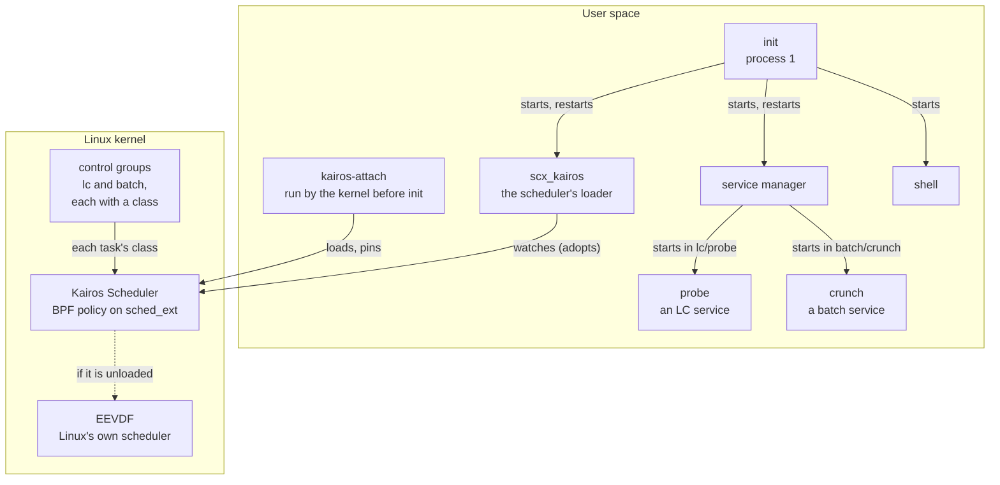
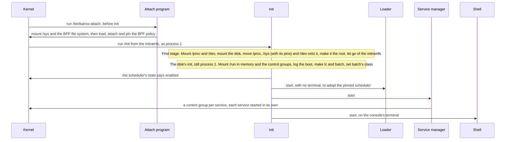

# Kairos

Kairos is an operating system built on the Linux kernel, around
[Kairos Scheduler](https://github.com/AayushNair10/KairOS-Scheduler): a CPU
scheduler for a latency-critical service that shares its CPUs with batch
work.

It has three parts:

- **The kernel:** upstream Linux at a pinned version, plus a short series of
  our own patches (`kernel/`).
- **User space:** our own init and service manager (`userspace/`). The
  shell and tools are busybox's for now.
- **The scheduler:** a BPF program on Linux's sched_ext, kept in its own
  repository and pinned here (`scheduler/`).

## Status

Early. A minimal Kairos kernel builds and boots in QEMU, and runs from an
ext4 disk that keeps its files from one boot to the next. The kernel attaches
Kairos Scheduler before it starts Kairos's own init, so every program runs
under it; init, the first process, watches it and starts it again if it
ends.
A service manager runs each service in a control group for its class,
latency-critical (LC) or batch. Four kernel patches make the class
something the kernel keeps: every control group has one, inherited by the
groups below it, and the scheduler asks the kernel for each task's class.
The CPUs kept for LC work follow the machine's layout: the fastest first,
close together, in whole cores. When memory runs short, the kernel takes it
from batch work first, and kills batch work first if it runs out. The shell
and tools are busybox's. The roadmap, and the reasoning behind each decision, are in
[`docs/DESIGN_LOG.md`](docs/DESIGN_LOG.md).

## Design

### The parts



- **The kernel** decides which task runs where. For ordinary tasks, sched_ext
  lets a BPF program make that decision instead of Linux's own scheduler,
  EEVDF. Kairos Scheduler is such a program. It keeps a pool of CPUs for LC
  work, sized to LC demand; batch work borrows idle LC CPUs, and an LC task
  that wakes up takes its CPU back.
- **The loader** hands the policy to the kernel. A pin, a file in the BPF
  file system, holds it there, so it keeps running whatever happens to the
  loader; removing the pin unloads it. Before it starts init, the kernel
  runs an attach program that loads the policy and pins it. The kernel
  also unloads the policy by itself if it breaks one of its rules or
  leaves a task waiting too long, and gives every task back to EEVDF.
- **init** is the first program, process 1. It starts a loader that adopts
  the pinned scheduler: it watches it and says how it ended. When the
  scheduler ends, init loads it again.
- **The service manager** runs the services. Each runs in a control group of
  its own, below the group for its class, and the scheduler reads each
  task's class from its group.

### What happens at boot



Until the policy is attached, only the kernel's own threads and the attach
program run, on EEVDF. Everything after that, init included, runs under
Kairos Scheduler. If the attach program fails, the kernel says so and boots
on, and init loads the scheduler itself, as it did before.

The initramfs, the archive the kernel unpacks into memory, holds the whole
system, so a boot without a disk still works. With a disk (`root=/dev/vda`
on the command line), init checks it before it changes anything, makes it
the root, and starts again from it; the initramfs's memory is freed. At
power-off init writes everything out and makes the disk read-only, so ext4
closes its journal and the next boot finds it clean.

### How a task gets its class

Control groups are folders in a file system of their own. Every process is
in exactly one, and a new process starts in its parent's group, so a
service and everything it ever starts stay together.

Kairos's kernel keeps a class for every group (our controller, `kairos`):
each group's `kairos.class` holds `lc`, `batch` or `inherit`, the default,
which takes the parent's class. The root is LC. At boot, init writes
`batch` into the batch group, and everything below it follows:

```
/sys/fs/cgroup              init, the shell, the loader, kernel threads  -> LC (the root)
├── lc                      inherit                                      -> LC
│   └── probe               inherit: the service probe                   -> LC
└── batch                   batch, written by init                       -> batch
    ├── crunch              inherit: the service crunch, all its processes -> batch
    └── cmd-123             inherit: a command run with "batch"           -> batch
```

`kairos.class.effective` shows a group's class in effect. A write to a
group's `kairos.class` changes it there and in every group below that
inherits, so the kernel keeps every group's class ready and a read is a
single load. The scheduler asks the kernel for a task's class at each
decision (`bpf_kairos_task_class()`), so a change applies at once, with
no restart:

```sh
echo lc > /sys/fs/cgroup/batch/crunch/kairos.class       # crunch is LC now
echo inherit > /sys/fs/cgroup/batch/crunch/kairos.class  # batch again
```

A task that has lowered its own scheduling policy to batch or idle is
batch whatever its group's class.

The boot test checks this end to end. With crunch keeping every CPU busy,
a small LC program's median wake-up delay was 2.5 to 14 times shorter with
crunch as batch than with crunch relabelled LC while it ran (in QEMU, on 1
to 4 CPUs).

### Which CPUs are LC

The scheduler keeps the first N CPUs of an order for LC work, N sized to
LC demand every millisecond. The order comes from the CPU layout the
kernel describes in `/sys`, read once when the scheduler loads:

1. the fastest CPUs first (on a phone-style chip, the big cores);
2. then one memory node, one shared cache and one cluster filled before
   the next, so a growing pool stays close together;
3. the hardware threads of a core side by side, and the pool rounded up
   to whole cores, so a batch task never shares a core with LC work.

For example, booted with CPUs 4 to 7 twice as fast as 0 to 3, the order
is `4 5 6 7 0 1 2 3` and the probe runs on the fast CPUs. On a machine where all
CPUs are alike and there are no threads, it is just `0 1 2 3 ...`.

### When memory runs short

The kernel charges every page of memory to the control group of the
program that first used it. When memory runs short it reclaims: it drops
cached file contents that can be read again from the disk (there is no
swap, so programs' own memory stays). Kairos's kernel lets the class steer
that (four patches):

- reclaim passes over LC groups while batch groups still have memory to
  give, as if LC were under its protected amount (`memory.low`); an idle
  LC service keeps its files in memory instead of reading them back from
  the disk on its next request;
- an LC program that needs memory while memory is very short may dip into
  the reserve, as realtime programs may, instead of stopping to reclaim
  it first;
- if memory runs out, the kernel kills a batch program before any LC one.

`kairos.nomemclass` on the kernel's command line turns all three off. On a
192 MB machine, with batch streaming a big file through memory and an LC
program re-reading its 16 MB every 2 s (`scripts/memory-test.sh`, 10
interleaved pairs), the LC program's time stalled on memory had a median
of 4 ms with the hooks and 154 ms without, and its file was pushed out in
none of the 10 runs with them and 6 of 10 without.

### When something fails

| What happens | Who notices | What follows |
|---|---|---|
| The loader ends: a crash, a kill | init | The scheduler keeps running, held by its pin. init starts a new loader, which adopts it: at once after a run of a minute or more, otherwise after 1, 2, 4 and 8 s, and it gives up after five short runs in a row. |
| The policy breaks a kernel rule, or a task waits 30 s | the kernel, then the loader | The kernel unloads the policy and gives every task back to EEVDF. The loader removes the pins and ends with a status that says why; init loads the scheduler again by the same rule, removing any pins left behind first. An unload someone asked for (SysRq-S) is left alone. |
| The attach program fails before init | the kernel | It says so and boots on; init loads the scheduler itself. |
| A service ends | the service manager: the service's group is empty | It starts the service again, by the same rule. |
| The service manager ends | init | It starts a new one, which finds the running services by their groups and looks after them. |
| The scheduler itself is the problem | you | Boot with `kairos.noscheduler`: the kernel and init leave it off, and EEVDF runs everything. |
| The disk is missing, or isn't ext4 | init, before it changes anything | It says so and runs from the initramfs, in memory. |
| The power goes off | ext4, at the next mount | It replays its journal ("recovery complete"): everything written out before the cut is there, consistent. |
| Memory runs out | the kernel | It kills a batch program before any LC one. |
| The kernel keeps no classes (one without our patches) | init: there is no `kairos.class` | It says so and starts the scheduler with the older rule: batch is anything below the group `batch`. |

## Layout

```
kernel/upstream    the pinned Linux version: its tag and commit id
kernel/patches/    our kernel changes, one numbered patch file each
kernel/config/     the kernel's config: a starting point, our switches, and
                   the switches of a lock-checking build
userspace/init/    Kairos's init: the first program the kernel starts
userspace/service/ the service manager, and the service and batch commands
userspace/probe/   a small LC program, run by the demo service probe
image/             the first file system: its list of files, the program
                   the kernel runs before init to attach the scheduler,
                   the services' descriptions, the boot test's self-test,
                   and a fallback first program
scheduler/         Kairos Scheduler, a git submodule at a pinned commit
scripts/           the scripts below
docs/              DESIGN_LOG.md: the roadmap and one entry per component
```

## Build and boot

This needs an arm64 Linux machine. On Ubuntu 26.04 these packages were
enough: `git gcc make flex bison bc perl pahole libelf-dev zlib1g-dev
libzstd-dev clang llvm qemu-system-arm busybox-static`.

```sh
git submodule update --init  # once: Kairos Scheduler at the pinned commit
./scripts/kernel-fetch.sh    # once: Linux at the pinned version + our patches
./scripts/kernel-build.sh    # put the config together and build the kernel
./scripts/image-build.sh     # build init, the services and the scheduler; pack the first file system
./scripts/disk-build.sh      # build the disk: an ext4 image with the same files
./scripts/boot-test.sh       # boot unattended and check what the console says
./scripts/layout-test.sh     # boot several CPU layouts; check where LC work runs
./scripts/disk-test.sh       # boot one disk four times, with a power cut
./scripts/memory-test.sh     # memory pressure: does LC keep its memory?
./scripts/run-qemu.sh        # boot to a shell; "poweroff" leaves
```

`run-qemu.sh` attaches the disk (`~/kairos-build/disk.img`, or `--disk
FILE`) and keeps what Kairos writes to it; `disk-build.sh` makes it fresh
again. `--no-disk` boots from memory only, and `--throwaway` discards the
writes when QEMU ends; the tests boot that way.

`run-qemu.sh` and `boot-test.sh` take a CPU layout as `--smp`, such as
`--smp 8,clusters=2,cores=2,threads=2`. `run-qemu.sh --qemu ARG` passes
more to QEMU (memory nodes, for example), and `--dtb FILE` boots with an
edited device tree; `layout-test.sh` uses both.

Everything built goes to `~/kairos-build` (set `KAIROS_BUILD` for another
place). `kernel-build.sh --debug` builds a slower kernel that checks
locking (lockdep) into `~/kairos-build-debug`; `run-qemu.sh` and
`boot-test.sh` boot it, or any other image, with `--kernel FILE`. The first build takes a few minutes on 4 CPUs. A boot to the shell
takes a few seconds, even with QEMU emulating every instruction.

## Services

A service is described by a file in `/etc/kairos/services` (from
`image/services/`), named after it:

```
class batch                  lc or batch
start manual                 boot (the default) or manual: only on request
run for i in $(seq $(nproc)); do while :; do :; done & done; wait
```

In the shell:

```sh
service status               # every service: class, state, CPU time used
service start crunch         # start it, reading its description again
service stop crunch          # ask it to finish; whatever is left after 5 s is killed
batch COMMAND                # run one command as batch work
```

The two demo services are `probe`, which wakes every 10 ms and logs how late
its wakeups were (`/run/service/probe/log`), and `crunch`, one busy loop per
CPU, started only on request.

## Init

`userspace/init/init.c` is the first program the kernel starts, and the
parent of everything else. It:

- started from the initramfs with a disk named on the command line, makes
  the disk the root: it waits for it, mounts it, checks it holds an init,
  moves the kernel's own file systems onto it, pivots, lets go of the
  initramfs, and replaces itself with the disk's init, still process 1. If
  anything is wrong before the switch, it stays in memory;
- mounts the file systems through which the kernel shows its own
  information, an in-memory `/run` for files about this boot only, and
  the control groups, with the groups `lc` and `batch`, writes `batch`
  into the batch group's class, and switches the CPU and memory
  controllers on for them (the memory controller below them too, so
  every service has its memory counted on its own);
- adds a line to the boot log on the disk (`/var/log/kairos/boots`),
  written out at once;
- keeps the file systems mounted before it started: the attach program's
  `/sys` and BPF file system, which hold the scheduler's pin;
- starts Kairos Scheduler's loader: one that adopts the scheduler the
  kernel attached, or, if none runs, one that loads and pins it, and then
  waits until the kernel runs it before it starts anything else;
- when the loader ends, reads its exit status and starts it again, unless
  the scheduler was stopped on purpose; after a short run it waits 1, 2, 4
  and 8 s first, and after five short runs in a row it gives up. If only
  the loader died, the scheduler keeps running meanwhile;
- starts the service manager, and starts it again when it ends;
- starts a shell, on the terminal behind the console, and starts a new one
  when that shell ends;
- collects every process that finishes, including the ones it adopted
  because their parent finished first;
- on `poweroff`, `reboot` or `halt`, asks every process to finish, waits,
  stops by force what is left, writes everything out, makes the disk
  read-only, and only then tells the kernel.

`boot-test.sh` checks each of these on a running system. If the scheduler
is ever what's broken, `./scripts/run-qemu.sh kairos.noscheduler` boots
without it. If init is, `./scripts/run-qemu.sh rdinit=/init.fallback`
boots with a shell script in its place.

## The scheduler

`scheduler/` is the Kairos Scheduler repository, pinned to a commit on its
branch `kairos-os`. That branch holds the changes made for this OS, so the
repository's `main` stays as it was evaluated:

- the loader's `--quiet` option, and an exit status that says why it ended;
- `--class=cgroup` and `--batch-cgroup`: a task's class from its control
  group's place in the tree;
- `--class=kernel`: a task's class from the kernel, asked at each
  decision. It still loads on a kernel without our patches, and refuses
  this option there;
- `--split-order=layout`: the order in which CPUs join the LC pool, by
  the CPU layout, and the pool in whole cores. It prints the order when
  it starts;
- `--pin DIR`, `--pin-and-exit DIR` and `--adopt DIR`: the scheduler held
  by pins in the BPF file system instead of by the loader, and a loader
  that watches a pinned scheduler. Old pins are removed before a new
  scheduler is loaded: releasing one unloads whichever scheduler runs. The
  policy's timers stop when the scheduler exits, so an unloaded scheduler
  whose pins remain leaves nothing running.

`scripts/scheduler-build.sh`, which `image-build.sh` runs, builds the BPF
library, bpftool and a header of the kernel's types from the pinned kernel
source, then the loader as one statically linked program. It goes into the
image as `/bin/scx_kairos`. The kernel switches it needs are in
`kernel/config/kairos.config`, each with the failure that showed it was
missing.

## The kernel tree

The Linux source isn't stored in this repository. `kernel/upstream` names
the version, `kernel/patches/` holds our changes to it, and
`kernel-fetch.sh` puts the two together into a working tree outside the
repository (`~/kairos-linux`; set `KAIROS_LINUX` for another place). It
downloads about 280 MB; `--from DIR` takes Linux from a git checkout that
is already on the machine instead.

To change the kernel: commit the change in the working tree, then

```sh
./scripts/kernel-export.sh   # write the tree's commits into kernel/patches/
./scripts/kernel-check.sh    # prove the tree and the patches agree; style check
```

and commit the new patch file here.

Our patches so far:

| Patch | What it does |
|---|---|
| 0001 | the `kairos` controller: `kairos.class` and `kairos.class.effective` in every group but the root; a new group takes its parent's class |
| 0002 | a write to a group's class reaches every group below it that inherits |
| 0003 | the controller's section in Linux's cgroup v2 document |
| 0004 | `bpf_kairos_task_class()`, a task's class for the BPF scheduler; `kairos_task_class()` for kernel code |
| 0005 | before init, the kernel runs `/bin/kairos-attach` from the first file system and waits for it; `kairos.noscheduler` skips it |
| 0006 | `kairos.noscheduler` in the kernel's list of boot parameters |
| 0007 | the out-of-memory killer takes batch tasks before LC ones; the `CONFIG_KAIROS_MEMORY` switch and `kairos.nomemclass` |
| 0008 | reclaim passes over LC groups while other groups have memory to give; `kairos_cgroup_class()`, a group's class |
| 0009 | LC tasks may dip into the allocator's reserves as realtime tasks may |
| 0010 | the memory hooks in the cgroup document, `kairos.nomemclass` in the boot parameters |

## The kernel config

`kernel/config/base` names a starting point that ships with Linux: every
optional switch off. `kernel/config/kairos.config` holds our switches on top
of it, each group with what it is for and what happened without it.
`kernel-build.sh` stops if one of our switches doesn't make it into the
final config.
